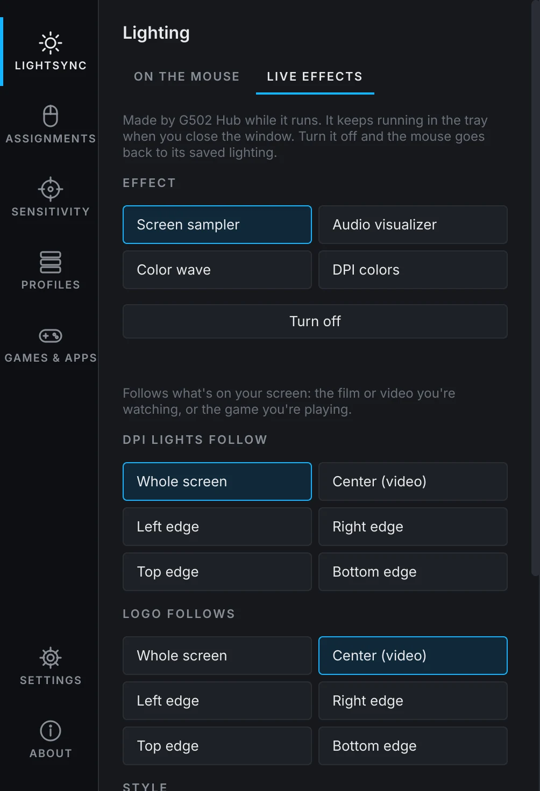
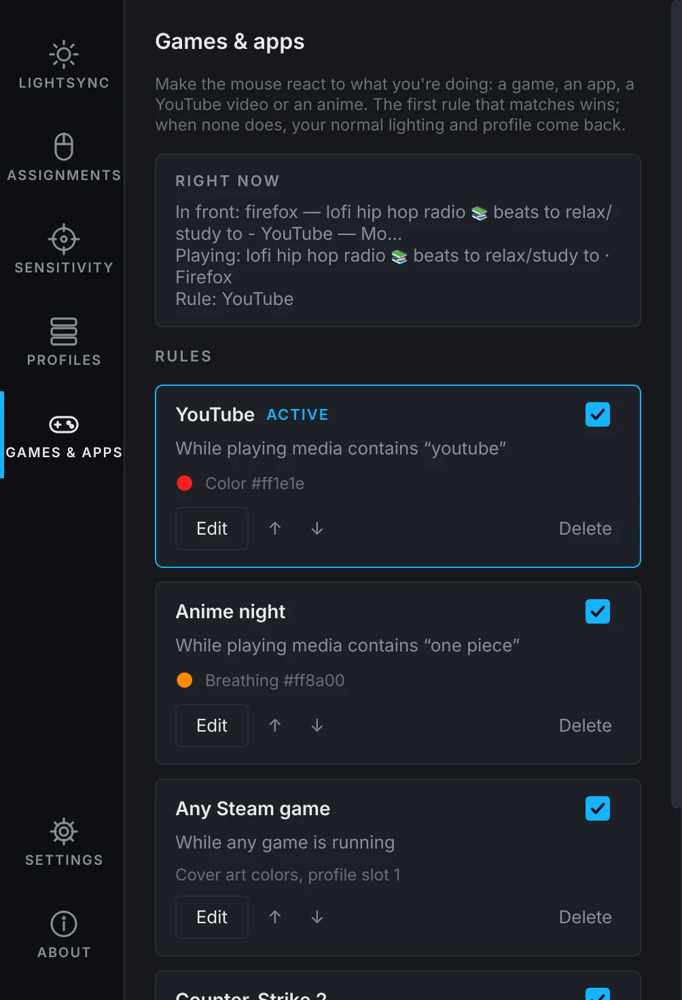
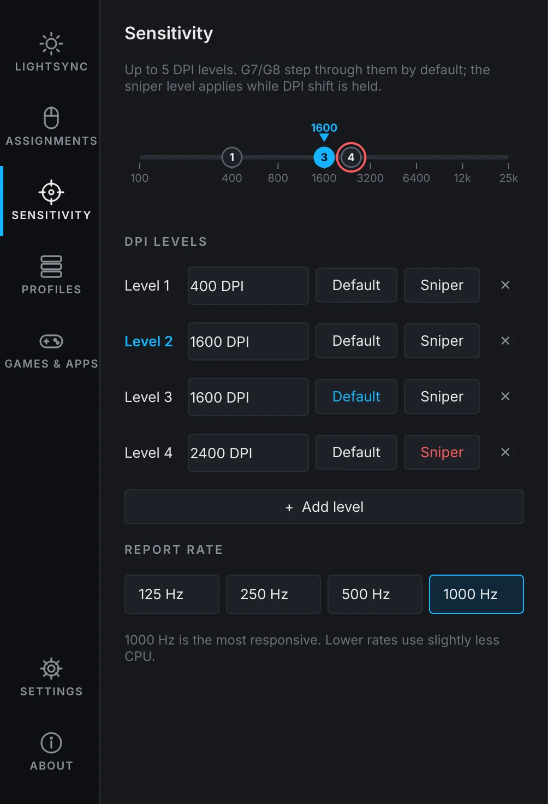
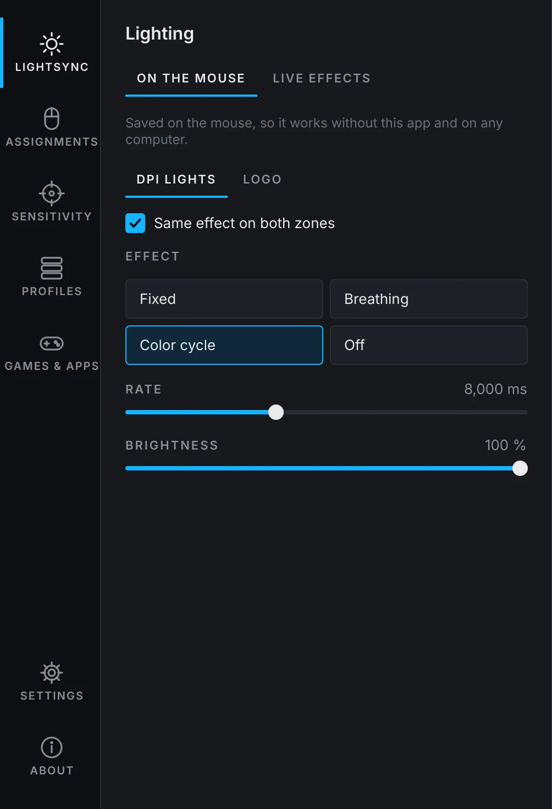
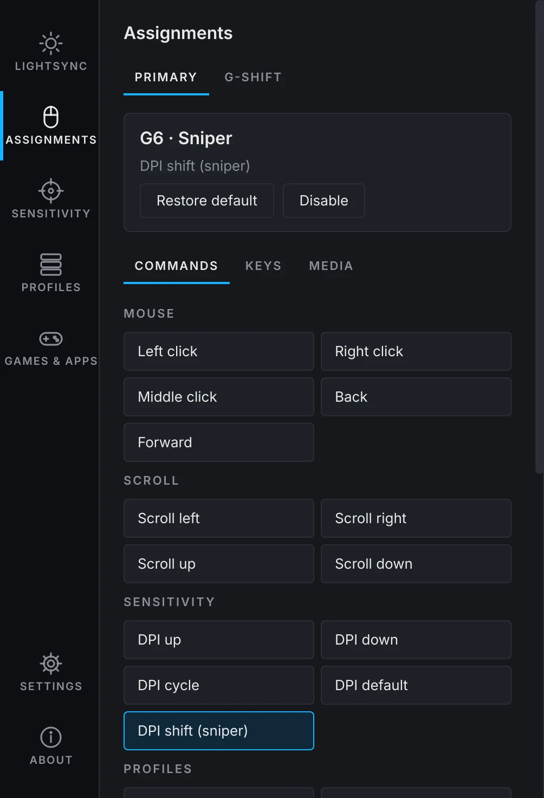
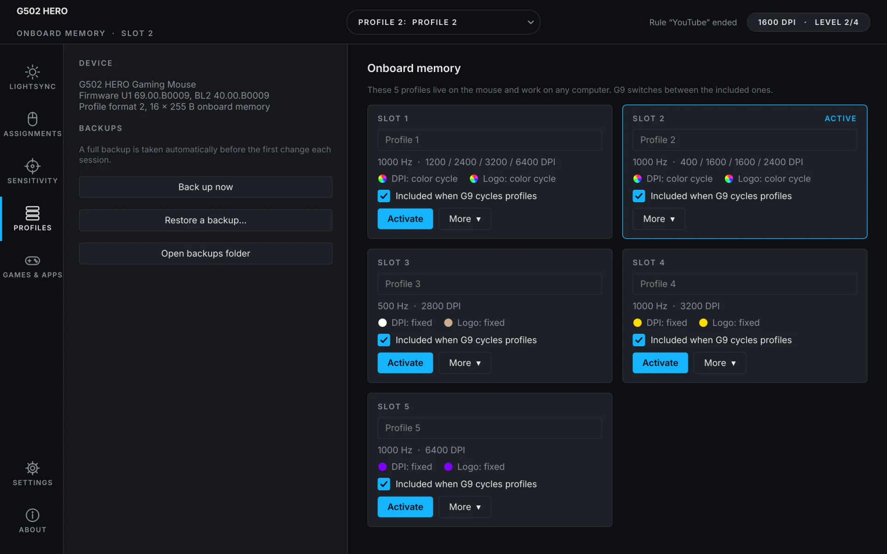

# G502 Hub

**The G HUB experience for the Logitech G502 HERO, on Linux.**

DPI levels and sniper, lighting with live screen, audio and game effects,
button remapping with G-Shift, five onboard profiles, and rules that change
everything when you start a game or a YouTube video. No Windows, no Wine,
no root.

<p align="center">
  
  
  
</p>

## Install

```sh
curl -fsSL https://Ahmedxsaad.github.io/g502-hub/install.sh | sh
```

It installs the dependencies with your package manager, puts the app in
`~/.local/share/g502-hub`, adds the permission rule that lets your user talk
to the mouse, and adds **G502 Hub** to your applications menu. Uninstall with
`curl -fsSL https://Ahmedxsaad.github.io/g502-hub/install.sh | sh -s -- --uninstall`.

On Arch, EndeavourOS, Manjaro or CachyOS you can also use the AUR:

```sh
yay -S g502-hub
```

Built and tested on EndeavourOS with KDE Plasma 6 (Wayland). Fedora and
Debian/Ubuntu package names in the installer are best effort; reports welcome.

Close Piper / ratbagd while using G502 Hub: ratbagd overwrites the mouse's
G-Shift layer whenever it saves.

## What it does

**Lightsync**
- *On the mouse*: Fixed, Breathing, Color cycle or Off for the DPI lights and
  the logo, together or separately. Saved in the mouse, so it works without
  the app and on any computer.
- *Live effects*, made by the app while it runs (it stays in the tray):
  - **Screen sampler**: the mouse glows with the film, video or game on your
    screen. Each zone follows the whole screen, the center or an edge.
  - **Audio visualizer**: pulse, spectrum or rainbow beats, from whatever is playing.
  - **Color wave** from the DPI lights to the logo.
  - **DPI colors**: the lights show which DPI level you're on.
- A color wheel with hex/RGB fields and your own saved colors.

**Sensitivity**: up to 5 DPI levels from 100 to 25,600 on a draggable track,
default and sniper level, report rate up to 1000 Hz. While you drag the level
you're on, the mouse's DPI follows so you can feel it. An on-screen popup
shows the new DPI when you change it.

**Assignments**: all 11 buttons, on the primary layer and the G-Shift layer:
mouse buttons, scrolling, DPI and profile controls, any key combination
(labelled for your keyboard layout), media keys.

**Macros**: record them by typing or build them step by step (keys, text,
waits, clicks, scrolling, media keys). Saved on the mouse they play on any
computer; run by the app they can also type text in your layout, repeat while
you hold the button, or toggle on and off.

**Profiles**: the 5 onboard slots: rename, activate, include in the G9 cycle,
reset to factory, copy, **export to a file and import** (share your setup),
plus full backups and restore.

**Games & apps**: rules like

| When | Then |
|---|---|
| YouTube is playing | red |
| an anime with "One Piece" in the title is playing | orange breathing, profile slot 3 |
| any Steam game is running | colors from the game's cover art, profile slot 1 |
| Counter-Strike 2 is running | game-driven: health, bomb, flashbangs |

Triggers: a game is running (Steam and Proton games are found automatically),
an app is in front, a window title contains something, or the media that's
playing contains something (browsers, mpv, VLC, Spotify, anime apps…).

**Game-driven lighting** (new in 0.2; reports from real matches welcome)
- **CS2 and Dota 2** through Valve's official Game State Integration (one
  click in Settings): health, team colors, bomb timer, flashbangs, kills, mana.
- **LIGHTSYNC bridge for Proton games**: Windows games with built-in Logitech
  lighting talk to a small `LogitechLed.dll` that G502 Hub adds to that game's
  Proton prefix, so they light the mouse like they do with G HUB on Windows.
  Experimental; turn it on per game in Settings.

## Screenshots

<p align="center">
  
  
  
</p>

Next to these panels the app shows a photo of your mouse with its lights
recolored live. That photo is Logitech's, so it isn't part of this project or
these screenshots: the app downloads it from logitechg.com the first time it
starts ([NOTICE.md](NOTICE.md)).

## Safety

G502 Hub talks to the mouse directly over HID++ 2.0 (`/dev/hidraw`), the same
protocol G HUB uses.

- Before its first change each session it saves a full backup of the mouse's
  memory to `~/.local/share/g502-hub/backups/`; any backup can be restored
  from the Profiles page.
- It writes only the user profile area, never the factory profiles, and reads
  every write back to check it.
- Bytes it doesn't understand are kept as they are; byte-exact round trips of
  real memory dumps are part of the tests.
- It never uses the hidden factory/engineering features of the firmware.
- Live effects only change the lights' RAM: quitting brings the saved
  lighting straight back.

## FAQ

**Does it support other G502 models?** Only the wired G502 HERO (USB
`046d:c08b`) so far. Other models need someone with one to help test; open
an issue with your "Copy for a bug report" info from the About page.

**Wayland?** Yes, that's what it's built on. Screen capture goes through the
desktop's screen-sharing portal (KDE asks once which screen to share), the
active window comes from a tiny KWin script, popups use Plasma's OSD. On
other desktops everything except active-window rules works.

**The mouse photo?** The picture of the mouse in the app is Logitech's
product photo. It isn't part of this project: the app downloads it once from
logitechg.com the first time it starts. See [NOTICE.md](NOTICE.md).

**Does anything leave my computer?** No. Screen and audio are analysed
locally, and nothing is sent anywhere. The only download is the mouse photo,
once, from Logitech's website.

## Command line

```sh
g502hub info            # device, firmware, live DPI/rate, LED zones
g502hub profiles        # all 5 onboard slots at a glance
g502hub show 2          # one slot: DPI, buttons + G-Shift layer, lighting
g502hub backup          # full onboard memory dump
g502hub restore FILE --yes

g502hub activate 3
g502hub set 2 --dpi 400,800,1600,3200 --default 3 --shift 1 --rate 1000 --name "Desktop"
g502hub bind 2 g7 key:ctrl+c
g502hub bind 2 g8 media:volume-up --gshift
g502hub led 2 all breathing 00dcff --period 4000 --brightness 80
g502hub disable 5       # skip slot 5 when cycling profiles with G9
g502hub spy             # print raw button presses (Mouse Button Spy)
```

From a source checkout use `python3 -m g502hub` instead of `g502hub`.

## Development

```sh
git clone https://github.com/Ahmedxsaad/g502-hub && cd g502-hub
sudo install -m644 udev/70-g502-hub.rules /etc/udev/rules.d/
sudo udevadm control --reload && sudo udevadm trigger --action=change --subsystem-match=hidraw
python3 -m g502hub.gui                     # the app
QT_QPA_PLATFORM=offscreen python3 -m pytest
sh bridge/logitechled/build.sh             # LogitechLed.dll (needs clang, llvm, lld)
QT_QPA_PLATFORM=offscreen tools/screenshots.py   # README / website screenshots
```

```
g502hub/hidpp.py       HID++ 2.0 transport over hidraw
g502hub/device.py      G502 features: 0x8100 onboard, 0x2201 DPI, 0x8060 rate, 0x8070 LEDs, 0x8110 spy
g502hub/onboard.py     profile/directory/binding/LED codecs (format 2)
g502hub/macro.py       onboard macro codec (format 1)
g502hub/backup.py      dump/restore
g502hub/sharing.py     profile files (.g502profile)
g502hub/rules.py       Games & apps rules
g502hub/context.py     what's happening: active window (KWin), media (MPRIS), Steam games
g502hub/lightfx.py     color maths for the live effects
g502hub/effects/       screen (portal + PipeWire), audio (parec), CS2/Dota 2 GSI, LIGHTSYNC receiver
g502hub/lightsync_bridge.py  installs the bridge into Proton prefixes
g502hub/gui/           the app (PySide6)
bridge/logitechled/    the LogitechLed.dll stand-in (freestanding C)
docs/protocol.md       wire protocol reference with sources
docs/hardware-notes.md behaviour verified on the real mouse
```

## Credits

Made by **Ahmed Saad**.

Built on the public work of [libratbag](https://github.com/libratbag/libratbag),
[Solaar](https://github.com/pwr-Solaar/Solaar),
[cvuchener/hidpp](https://github.com/cvuchener/hidpp),
[OpenRGB](https://gitlab.com/CalcProgrammer1/OpenRGB) and the Linux kernel's
`hid-logitech-hidpp` driver, whose notes on Logitech's HID++ protocol helped
map the mouse (see [docs/protocol.md](docs/protocol.md)).

## License

[GNU GPL v3 or later](LICENSE). See [NOTICE.md](NOTICE.md) for trademarks,
the mouse photo, third-party components and privacy.

An unofficial, independent project. Not affiliated with, endorsed or supported
by Logitech. Logitech, Logitech G, G HUB, LIGHTSYNC, HERO and G502 are
trademarks of Logitech Europe S.A.
